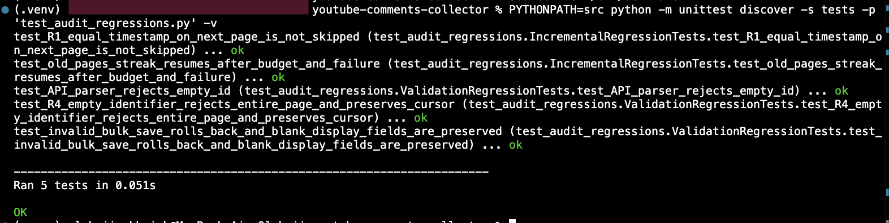
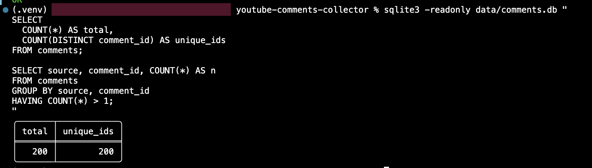
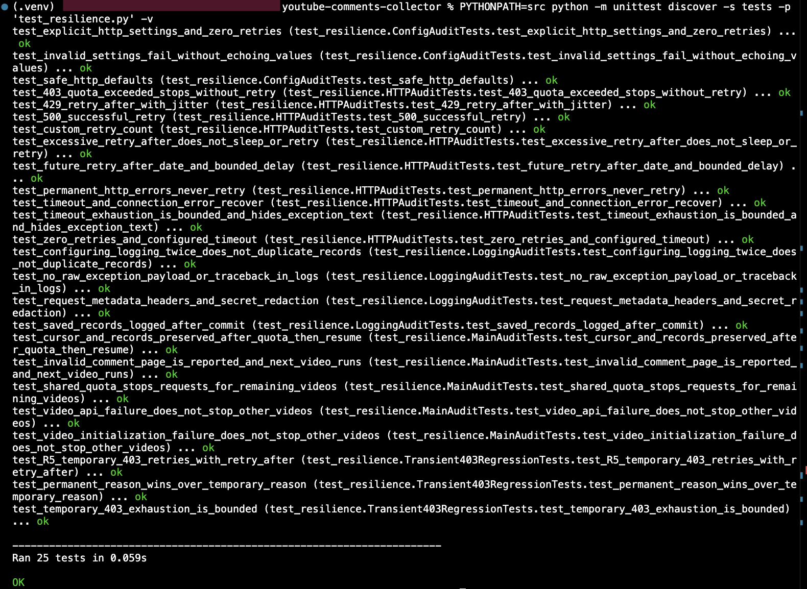
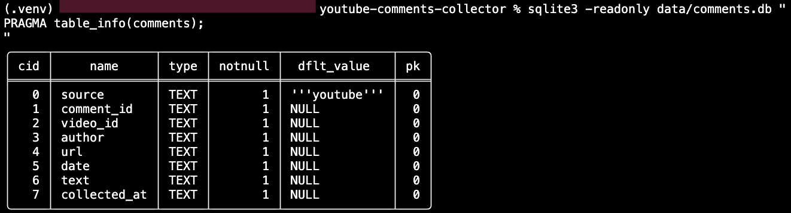
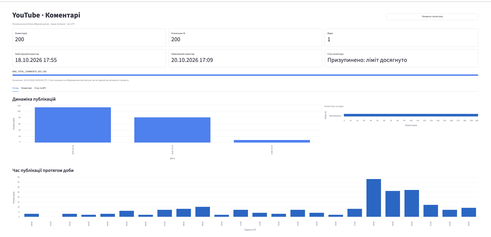

# youtube-comments-collector

Збір публічних top-level коментарів YouTube через **YouTube Data API v3**.

Основне:
- інкрементний збір із збереженням стану;
- SQLite + CSV/JSONL;
- dedup та ідемпотентні повторні запуски;
- pacing, retry/backoff, обробка 429/403/5xx;
- локальний Streamlit Dashboard;
- Docker / Docker Compose;
- 129 автоматизованих тестів.

## Відповідність вимогам

| Вимога | Реалізація |
|---|---|
| Інкрементний збір | `cursor` / watermark / persisted state; незавершений прохід продовжується після перезапуску |
| Канонічна модель | SQLite; експорт у CSV та JSONL |
| Повага до лімітів | затримка між запитами, timeout, bounded retries, exponential backoff, jitter, `Retry-After` |
| Стійкість і dedup | транзакції SQLite, логування, `UNIQUE(source, comment_id)`, `INSERT OR IGNORE` |
| Конфіг | секрети та `VIDEO_IDS` у `.env`; є `requirements.txt` і README |
| Docker | `Dockerfile`, `compose.yaml`, `.dockerignore`; Dashboard і тести перевірені в контейнері |

## Канонічна модель даних

Таблиця `comments`:

| Поле | Призначення |
|---|---|
| `source` | джерело (`youtube`) |
| `comment_id` | унікальний ID коментаря |
| `video_id` | ID відео |
| `author` | автор |
| `url` | постійне посилання |
| `date` | дата публікації |
| `text` | текст |
| `collected_at` | час збору |

Dedup:
```sql
UNIQUE(source, comment_id)
```

## Швидкий запуск

### 1. Python environment

```bash
python3.14 -m venv .venv
source .venv/bin/activate
python -m pip install -r requirements.txt
```

### 2. Конфігурація

```bash
cp -n .env.example .env
```

Основні змінні:

| Змінна | Default |
|---|---:|
| `YOUTUBE_API_KEY` | — |
| `VIDEO_IDS` | — |
| `REQUEST_DELAY_SECONDS` | `1.0` |
| `MAX_TOTAL_COMMENTS` | `200` |
| `MAX_PAGES_PER_RUN` | `5` |
| `HTTP_MAX_RETRIES` | `3` |
| `HTTP_CONNECT_TIMEOUT_SECONDS` | `5` |
| `HTTP_READ_TIMEOUT_SECONDS` | `30` |
| `HTTP_MAX_RETRY_WAIT_SECONDS` | `120` |

`.env` потрапляє в Git.

### 3. Інкрементний збір

```bash
PYTHONPATH=src python -m youtube_collector.main
```

Історичний backfill:

```bash
PYTHONPATH=src python -m youtube_collector.main --mode backfill
```

## Інкрементність і dedup

- стан зберігається окремо для кожного `video_id`;
- використовуються watermark, page cursor і pending state;
- сторінка та її стан записуються однією SQLite-транзакцією;
- після збою курсор не просувається до незбереженої сторінки;
- повторні записи ігноруються через унікальний ключ;
- повторний запуск не дублює вже збережені коментарі.

Обмеження: алгоритм використовує finite lookback; довільний reorder API далеко за межі вікна не має абсолютної гарантії повноти.





## Ліміти та помилки API

Реалізовано:
- pacing між HTTP-запитами;
- connect/read timeout;
- bounded retries;
- exponential backoff;
- jitter;
- `Retry-After`;
- HTTP `429`;
- тимчасові `403 rateLimitExceeded` / `userRateLimitExceeded`;
- `500/502/503/504`;
- timeout / connection errors;
- зупинка при `quotaExceeded` / `dailyLimitExceeded`.



## Експорт

SQLite → JSONL:

```bash
PYTHONPATH=src python -m youtube_collector.export --format jsonl --output data/comments_sample.jsonl
```

SQLite → CSV:

```bash
PYTHONPATH=src python -m youtube_collector.export --format csv --output data/comments_sample.csv
```

## Тести

```bash
PYTHONPATH=src python -m unittest discover -s tests -q
```

Поточний результат:

```text
Ran 129 tests
OK
```



## Streamlit Dashboard

Запуск:

```bash
python -m streamlit run dashboard.py --server.address=127.0.0.1 --server.port=8501
```

URL:

```text
http://127.0.0.1:8501
```

Dashboard:
- читає SQLite у read-only режимі;
- не запускає collector;
- не робить YouTube API-запитів;
- показує статистику, графіки, коментарі, фільтри та стан збору.



## Docker

Файли:
- `Dockerfile`
- `compose.yaml`
- `.dockerignore`

Збір образу:

```bash
docker compose build
```

Тести в контейнері:

```bash
docker compose run --rm tests
```

Перевірено:

```text
Ran 129 tests
OK
```

Запуск Dashboard:

```bash
docker compose up -d dashboard
docker compose ps
```

Перевірений стан сервісу:

```text
healthy
127.0.0.1:8501->8501/tcp
```

Запуск collector:

```bash
docker compose run --rm collector
```

Backfill:

```bash
docker compose run --rm collector   python -m youtube_collector.main --mode backfill
```

Зупинка:

```bash
docker compose down
```

`data/` і `logs/` монтуються з хоста. `.env` не копіюється в image і монтується read-only.

## Структура проєкту

```text
youtube-comments-collector/
├── src/youtube_collector/
│   ├── api.py
│   ├── collector.py
│   ├── config.py
│   ├── storage.py
│   ├── export.py
│   └── dashboard_data.py
├── tests/
├── screenshots/
├── data/
├── logs/
├── dashboard.py
├── requirements.txt
├── Dockerfile
├── compose.yaml
├── .dockerignore
├── .env.example
└── README.md
```

## Відомі обмеження

- збираються тільки top-level comments; replies не реалізовані;
- абсолютна повнота при довільному reorder YouTube API не гарантується finite lookback;
- Dashboard показує локальний стан, а не залишок Google Cloud quota;
- реальні rate-limit помилки не провокуються навмисно — сценарії перевірені mock-тестами;
- `MAX_TOTAL_COMMENTS` є глобальним лімітом таблиці.
